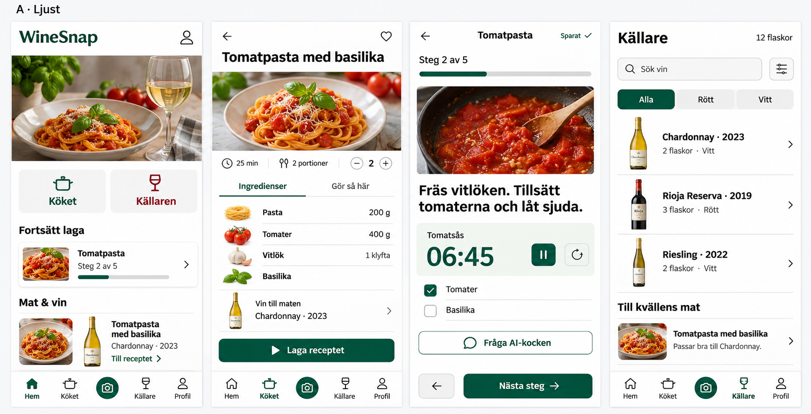
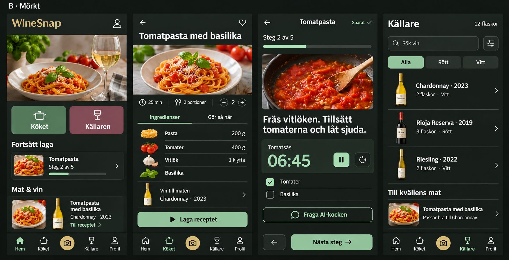

# Food And Wine Design Comparison

Date: 2026-11-05. Status: both concepts delivered; owner selected B (dark).
These are AI-generated raster design references, not functional app screens.
They have no API connection, real user data, implemented timer or camera.
No actual application component, runtime configuration or production is changed.

## A: Light

Cool white/neutral surfaces, dark type, forest-green kitchen accents and burgundy
wine accents. Designed for a clear, practical food-and-wine experience.

## B: Dark

Near-black neutral surfaces, soft-white type, sage-green kitchen accents, muted
wine accents and restrained brass. The second board was generated as an edit of
the first, keeping the same example content and overall screen arrangement.

## Comparison Contract

Both boards show Home, recipe detail, Cook Mode and Cellar in that order.
Both use the same tomato pasta example, two portions, timer value, cellar list
and kitchen/cellar entry points. The five-position navigation preserves direct
camera access; focused Cook Mode omits unrelated global navigation.

The generated photos, bottles, wine names, quantities and pairing text are
illustrative examples, not source-verified product facts, actual inventory or
nutrition/pairing evidence. Do not crop these boards into production wine photos
or treat their pictured pairing as a verified recommendation.

Raster rendering may differ in minor typography or spacing. On implementation,
use the existing icon library and real authorized assets; enforce readable body
type, accessible controls, maximum 8px content-card corners, proper focus and
responsive constraints in code. Contrast, accessibility and interaction must be
tested in the actual app rather than inferred from these images.

## Asset Provenance

Generated with the image-generation tool on 2026-11-05. No user account, cellar,
API key, private uploaded bottle photo or other private file was sent as input.
The light board was text-generated; the dark board used only that generated light
board as its image reference. The original generated files remain intact outside
the repository; these PNG copies are hash-identical to the originals.

The prompts specified four complete equal-scale mobile views, real-looking food
and wine imagery, short Swedish copy, matching example content, equal food/wine
weight, no big scan CTA, familiar icons and compact practical layouts. Light was
specified as cool neutral/forest/burgundy; dark as neutral charcoal/sage/wine/brass.

The PNGs live only under `docs/design`, not the application asset pipeline. They
must not be shipped as backgrounds or substituted for working screen components.

## Approval Gate

The owner requested comparison before implementation. Do not infer a selection
from generated output, a preferred answer's position, or a generic request to
continue. The owner explicitly selected concept B (dark) on 2026-11-05 and
opens stage 2 of the actual app, not general release permission. See the
[delivery plan](../../pilot-development-plan-2026-11-05.md).
